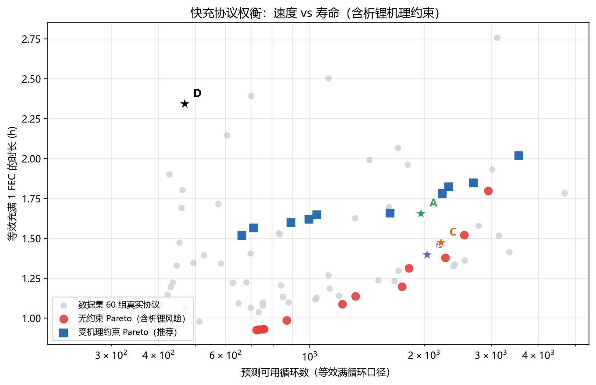
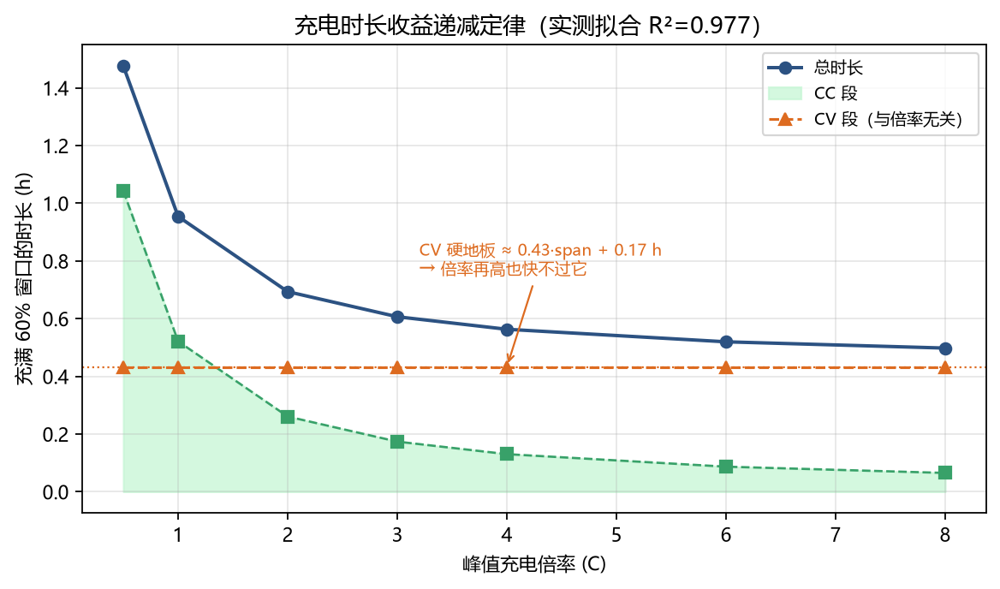
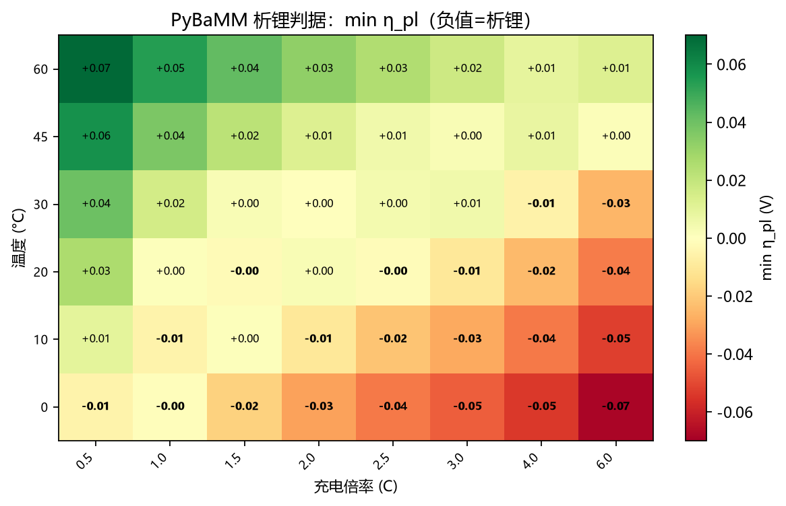
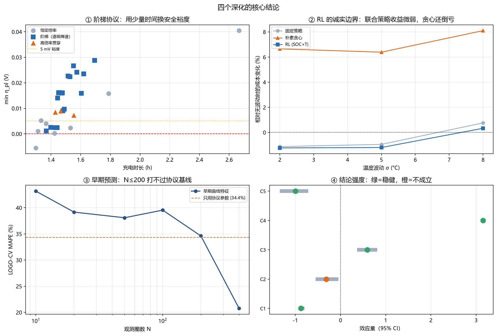
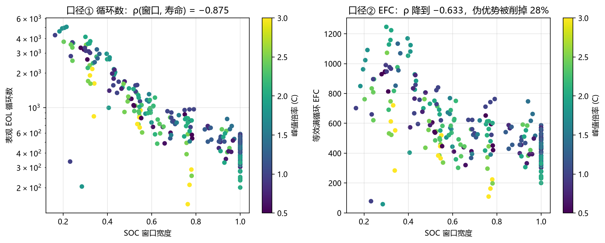

# Fast-Charging Protocol Optimization (A3)

[](https://github.com/ilo-love7/battery-fastcharge-opt/actions/workflows/ci.yml)
[](https://www.python.org/)
[](https://pybamm.org)
[](LICENSE)

> 240 cells, 61 charging protocols from ISU-ILCC, one question: **how should you tune a charging protocol to be fast without killing the cell?**

`Python 3.10+` · `PyBaMM` · `scikit-learn` · `45 tests passing` · 中文: [README.zh-CN.md](README.zh-CN.md)



---

## Three findings (read this first)

### 1. Charging time has a physical floor

Fitted on the real charging traces of 240 cells:

```
t_charge = 0.869·span/rate + 0.432·span + 0.173   [hours]
           └─ CC phase ─┘   └── CV phase (rate-independent) ──┘
```

Back-substitution: **R² = 0.978, MAPE = 5.7%**. The naive "pure CC" assumption (`span/rate`) gives MAPE **47.4%** — hopelessly wrong, because every ISU-ILCC protocol is CC-CV to 4.2 V.

**Consequence**: going from 1 C to 8 C (8× the rate) only cuts the time from 0.95 h to 0.50 h (−48%), and the last leg (4→8 C) buys essentially nothing. The CV floor `0.43·span + 0.17 h` is unavoidable.



### 2. SOC window matters an order of magnitude more than rate

Kruskal-Wallis effect size ε² (n=239):

| Factor | ε² | p |
|---|---|---|
| Start SOC | **0.737** | 4e-37 |
| SOC window width | **0.729** | 1e-36 |
| Discharge rate | 0.058 | 9e-04 |
| **Peak charge rate** | **−0.004** | 0.56 |

On the full sample, peak rate has essentially **no explanatory power**, because it is heavily confounded with SOC window across the 63 protocols.

> ⚠️ **Correction (see deep-dive §4)**: controlling for the window does surface the rate effect
> (ρ = −0.317, p = 0.010), but a **permutation test gives p = 0.173** and the **cluster bootstrap
> interval crosses zero** — five stratified layers all have zero-crossing intervals.
> **The evidence is insufficient.** The data simply cannot constrain a rate exponent
> (which is also why the damage model fitted p ≈ 0.12).

### 3. 10 of 12 unconstrained Pareto points sit in the plating regime



The unconstrained multi-objective BO returns 12 Pareto protocols. Run each through PyBaMM (30 °C, criterion `η_pl ≥ 0`):

- **10 of 12 violate** (5 with clearly negative η_pl — real lithium plating)
- Wilson 95% CI on the violation rate: **[56%, 96%]** — even the most conservative estimate keeps it above half
- Re-optimizing with the mechanism as a hard constraint pushes the fastest endpoint from 0.93 h to 1.52 h (+64%)
- **Yet the constrained front still beats the 0.5 C full-window baseline: −35% time, +41% cycle life**

---

## Four deep dives (v1.1)



| Deep dive | Core finding | Nature |
|---|---|---|
| **① Cascade protocols** | `3C@4V → 2C@4.1V → 1C@4.2V` is **5.6% faster than constant 1.5C while having 5.9× the plating margin**; 25 dominance relations in total | ✅ positive |
| **② RL / DP** | Q-learning matches DP **exactly on 7/7 λ values** (independent validation); but under temperature noise the joint RL policy is worth only **+0.3%** while naive greedy is **−7%** | ⚖️ validation OK / gain negative |
| **③ Early-life prediction** | Needs **N=400 cycles** to reach MAPE 20.8% (protocol baseline 34.4%); **N≤200 is worse than the baseline** | ⚠️ partly negative |
| **④ Robustness** | 4/5 claims survive permutation tests; **the rate effect (C2) has perm p=0.17 → not robust** | 🔍 self-refuting |

**Why cascades can dominate**: a constant-rate protocol is hostage to its worst segment.
Cascades allocate rate by SOC — 3 C where the plating margin is large, 1 C where it isn't.

**RL's honest position**: not a better solver (DP is already exact and runs in milliseconds);
its only value is adapting to observed uncertainty, measured at 0.3% —
**not worth 20k training episodes**.

**Early-prediction threshold**: N=50 at 38% MAPE is fine for **coarse screening** (94% bench-time saving);
**ranking** requires N=400 (53% saving). **Never use N≤200 for absolute lifetime prediction** —
it is worse than protocol parameters alone.

Full detail: [reports/深化报告-A3.md](reports/深化报告-A3.md).

---

## The metric trap: never model `cycle_number` directly

The most important methodological finding here.

Shallow cycling (window 0.3) at 3000 cycles = 900 EFC. Full cycling (window 1.0) at 400 cycles = 400 EFC. **Model `eol_cycle` directly and "shallow charging" looks dominant while the rate effect vanishes** — a textbook Simpson's paradox.



| Feature | vs eol_cycle | vs EFC | Δ |
|---|---|---|---|
| `soc_span` | −0.875 | −0.633 | +0.24 |
| `rate_peak` | +0.056 (p=0.39) | −0.097 (p=0.13) | −0.15 |

Switching to the EFC basis removes **28%** of shallow charging's apparent advantage (0.875 → 0.633), and the rate coefficient flips negative. **Pick the wrong metric and the conclusion points the wrong way.**

Both bases are implemented here (`lifetime.add_throughput_columns`); the report always shows both.

---

## Quick start

```bash
python -m venv .venv
.venv/bin/pip install -r requirements.txt     # Windows: .venv/Scripts/pip

# ISU-ILCC unified-format zip (240 cells, 10.06 GB)
export FASTCHARGE_ISU_ZIP=/path/to/ISU_ILCC.zip
# https://iastate.figshare.com/articles/dataset/_b_ISU-ILCC_Battery_Aging_Dataset_b_/22582234

# Core pipeline (~45 min, indexing 12 min)
python scripts/01_index.py           # stream the zip → cells/cycles tables (no 29 GB unpack)
python scripts/02_eda.py             # protocol → lifetime stats + 5 EDA figures
python scripts/03_surrogate.py       # LOGO-CV over four model families + SHAP
python scripts/04_optimize.py        # multi-objective BO (speed vs life)
python scripts/05_physics.py         # PyBaMM plating map + Pareto audit
python scripts/06_constrained_opt.py # mechanism-constrained re-optimization
python scripts/07_recommend.py       # physics vs measured cross-check + protocol cards
python scripts/08_readme_figures.py  # headline figures

# Deep dives (v1.1, ~30 min)
python scripts/09_multistage.py      # cascade protocols via PyBaMM
python scripts/10_rl.py              # DP vs Q-learning
python scripts/11_early.py           # early-life prediction
python scripts/12_robustness.py      # bootstrap + permutation tests
python scripts/13_deepening_summary.py

# Tests — synthetic cells only, no dataset needed
python -m pytest tests -q            # 45 passed
```

Or run everything: `bash scripts/run_all.sh`

---

## Layout

```
src/fastcharge/
  config.py      paths, EOL 80%, 0.25 Ah nominal
  index.py       streaming ISU-ILCC zip indexer
  protocol.py    63 protocols → structured features (rate / SOC / thermal families)
  lifetime.py    EOL detection, dual basis (cycles vs EFC), statistical tests
  chargetime.py  CC + CV + tail charge-time model + cascade protocol timing
  surrogate.py   Ridge / GP / RF / XGB, LOGO-CV, SHAP
  optimize.py    multi-objective BO (Sobol + dual-axis EI + applicability domain)
  physics.py     PyBaMM plating criterion (η_pl) + safe-rate envelope + cascade sim
  damage.py      damage-density model δ(s,r) with closed-form integration
  multistage.py  cascade search + per-stage damage decomposition
  rl.py          MDP, exact DP, tabular Q-learning, stochastic environment
  early.py       early-life features and prediction

scripts/       01–13, each independently runnable, artefacts land in results/
tests/         45 unit tests, synthetic data, CI runs without the dataset
reports/       基准评测报告-A3.md + 深化报告-A3.md
results/       metrics (50+ tables) / figures (14) / models (GP surrogate)
docs/figures/  4 headline figures + 1 deep-dive summary
```

---

## Implementation notes (the traps we hit)

**Don't unpack 29 GB.** The 10.06 GB zip expands to 29.7 GB across 1.2 M files. All 240 `.pkl` members are streamed with `zipfile` and reduced to scalars: `cells.parquet` (240 rows) + `cycles.parquet` (1.195 M rows), peak RSS < 300 MB, 718 s total.

**Normalize capacity by the SOC window.** Each cell charges over a slice (0.16–1.0), so `max(charge_capacity)` must be divided by the window width, or shallow cells are under-estimated 3–6×.

**Group the CV folds.** Four cells per protocol are replicates; random KFold leaks. Everything here is Leave-One-Group-Out (61 folds).

**Never use `Negative electrode potential [V]` as the plating test.** That variable is solid-phase potential φ_s with a model-internal reference — it sits at ~0 V regardless of rate, so comparing it to 0 V yields "no rate ever plates". The only self-consistent criterion is the plating reaction overpotential `η_pl = φ_s − φ_l − 0 < 0`.

**Use the OKane2022 parameter set.** `Chen2020` lacks `Typical plated lithium concentration` and friends; enabling `lithium plating` raises `KeyError` outright.

**Take the *contiguous* safe range, not the max safe point.** Under SPM η_pl is **non-monotonic** in rate (the electrode surface hits the cutoff early at high rate and drifts back to safety), so "max safe rate" would claim 4–6 C is fine. This repo uses the upper bound of the contiguous safe segment starting from the lowest rate.

**Normalize the time objective per FEC.** With "per-charge time" vs "EFC life", the optimizer drives window → 0 and rate → max and returns "3.99 C charging only 30%" — fast, but you need three of them to equal one full cycle. Dividing by `span` puts the front back on the real trade-off.

**An applicability domain stops GP extrapolation theatre.** A GP reverts to its prior mean far from data, and BO will happily walk there. Candidate points beyond the P95 pairwise training distance (3.42) are rejected. The design-coverage grid is reported too — the 2.5–3 C × 0.85–1.0 window cell contains **exactly zero cells**.

---

## Protocol cards

| Card | Window | Rate | Discharge | Full charge | Per-FEC time | Pred. cycles | vs 0.5C full window |
|---|---|---|---|---|---|---|---|
| **A mechanism-conservative** | 0.50 | 0.99 C | 1.0 C | 0.83 h | 1.66 h | 1958 | −29% time / +319% life |
| **B data-backed** | 0.45 | 1.50 C | 1.2 C | 0.63 h | 1.40 h | 2032 | **−40% / +335%** |
| **C balanced** | 0.50 | 1.25 C | 1.1 C | 0.74 h | 1.47 h | 2211 | −37% / +373% |
| D baseline | 1.00 | 0.50 C | 0.5 C | 2.34 h | 2.34 h | 468 | — |

- Expensive cells / no thermal management → **A**
- Liquid cooling / periodic plating inspection → **B**
- General automotive → **C**

---

## Accuracy ceiling (not a tuning problem)

Variance decomposition (`surrogate.variance_ceiling`):

| Target | between-group SS / total SS = **R² ceiling** | Best model R² | Fraction of ceiling |
|---|---|---|---|
| log(cycles) | **0.877** | 0.744 (Ridge) | 85% |
| log(EFC) | **0.594** | 0.242 (Ridge) | 41% |

The remaining ~40% is **cell-to-cell variability** — within one protocol, the four cells differ in life by up to 1.45×. The dataset carries no cell-level covariates (electrode thickness, electrolyte loading), so nothing further can be squeezed. Predicting each protocol by its own group median — the cheating upper bound — only reaches R² = 0.892 / 0.699.

---

## Limitations

1. The plating criterion uses OKane2022 (NMC811/graphite-SiO₂) while ISU-ILCC is NMC/graphite 0.25 Ah pouch — **boundary shape and relative trend only**, not absolute truth
2. Very shallow windows (span≤0.35) show 95% surrogate MAPE; point predictions are unusable there, ranking only
3. The charge-time model is measured only over 0.5–3 C; the 8 C row illustrates the trend, it is not an engineering promise
4. The applicability domain is necessary, not sufficient
5. Every ISU-ILCC experiment runs at a constant 30 °C; seasonal real-world temperature cycling is not covered

Full list in [reports/基准评测报告-A3.md](reports/基准评测报告-A3.md) §8.

---

## References

- **Data**: ISU-ILCC Battery Aging Dataset — Cell Reports Physical Science 2024, [DOI 10.1016/j.xcrp.2024.101891](https://doi.org/10.1016/j.xcrp.2024.101891)
- **Method anchor**: Attia et al., *Closed-loop optimization of fast-charging protocols*, Nature 2020, [DOI 10.1038/s41586-020-1994-5](https://doi.org/10.1038/s41586-020-1994-5)
- **Mechanistic simulation**: PyBaMM — [pybamm.org](https://pybamm.org); OKane2022 parameter set

Increment over Attia 2020: **the plating criterion is an explicit optimization constraint**, where that work is pure black-box closed-loop search.

---

MIT License
