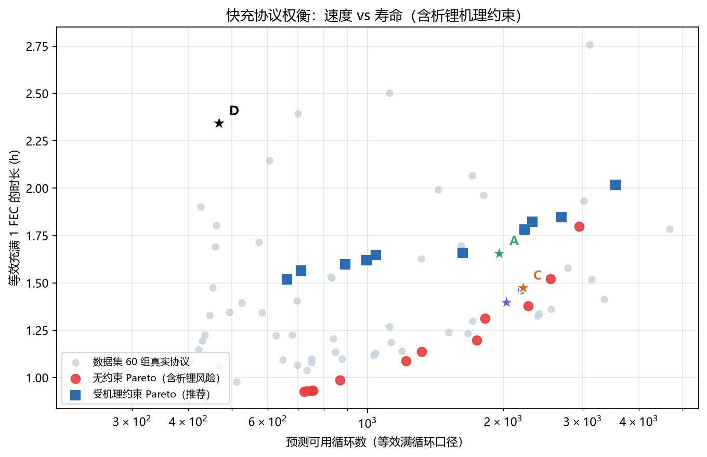
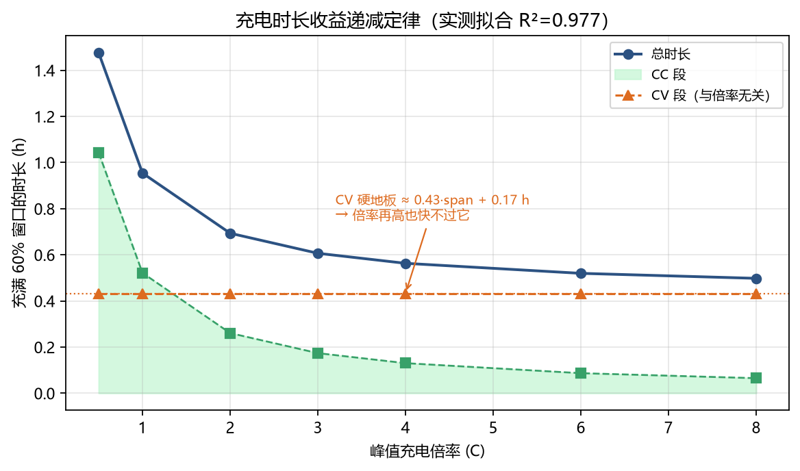
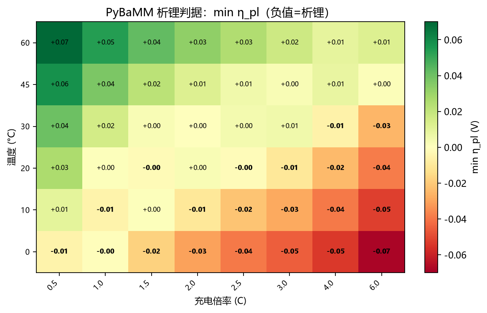
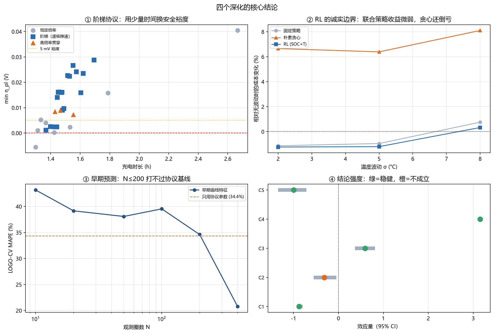
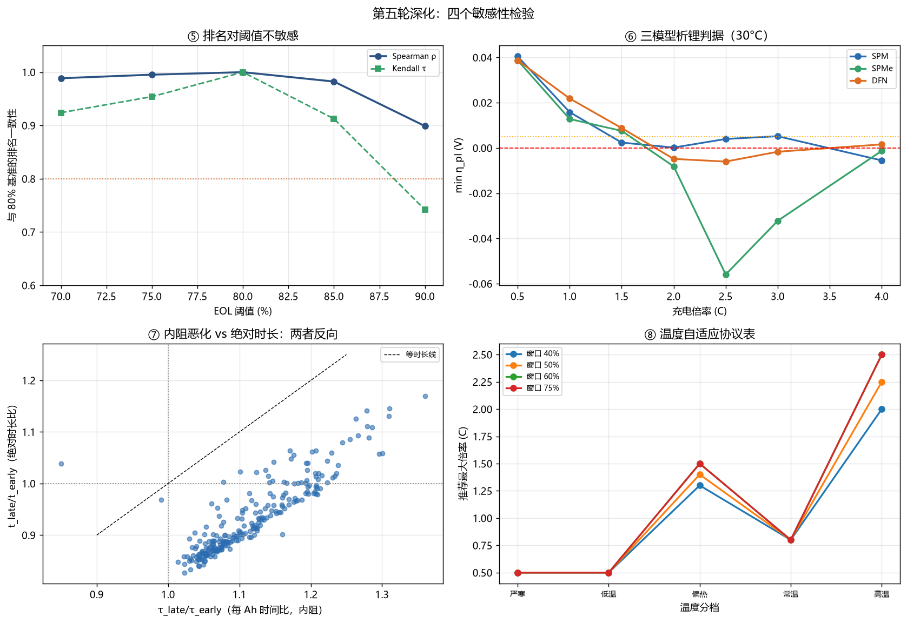
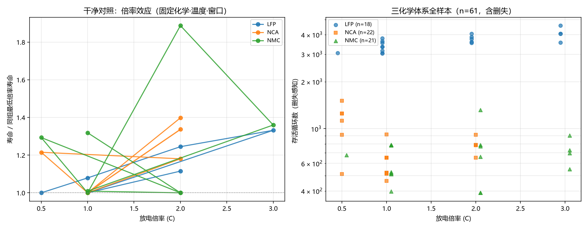
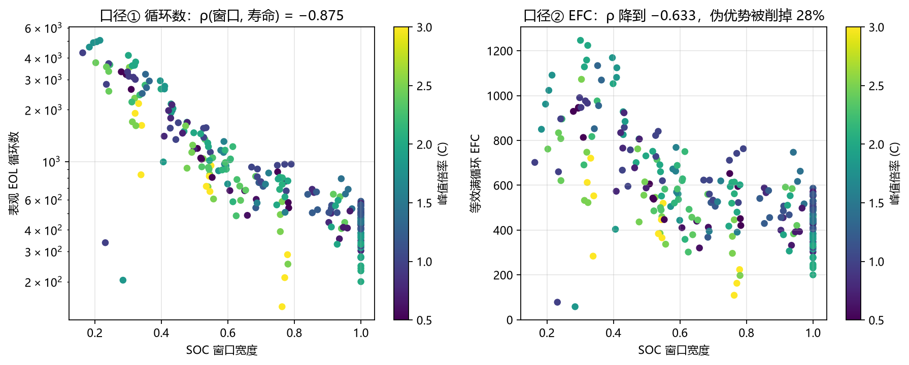

# 快充策略优化（A3）

[](https://github.com/ilo-love7/battery-fastcharge-opt/actions/workflows/ci.yml)
[](https://www.python.org/)
[](https://pybamm.org)
[](LICENSE)

> 用 ISU-ILCC 的 240 只电芯、61 种充电协议，回答一个问题：**充电协议怎么调，才能又快又不伤电池？**

`Python 3.10+` · `PyBaMM` · `scikit-learn` · `72 tests passing` · English: [README.md](README.md)



---

## 三个结论（先看这个）

### 1. 充电时长有物理硬地板

实测 240 只电芯的充电曲线拟合出：

```
t_charge = 0.869·span/rate + 0.432·span + 0.173   [小时]
           └─ CC 段 ─┘      └── CV 段（与倍率无关）──┘
```

回代得到 R² = 0.978、MAPE = 5.7%。而"纯 CC 假设"（span/rate）的 MAPE 是 **47.4%**——错得离谱，因为 ISU-ILCC 全部协议都是 CC-CV 到 4.2 V。

**推论**：倍率从 1 C 推到 8 C（涨 8 倍），时长只从 0.95 h 降到 0.50 h（降 48%），末段 4→8 C 几乎没有增益。**CV 段的 `0.43·span + 0.17 h` 是绕不过去的。**



### 2. SOC 窗口比倍率重要一个量级

Kruskal-Wallis 效应量 ε²（n=239）：

| 要素 | ε² | p |
|---|---|---|
| 充电起始 SOC | **0.737** | 4e-37 |
| SOC 窗口宽度 | **0.729** | 1e-36 |
| 放电倍率 | 0.058 | 9e-04 |
| 峰值充电倍率 | **−0.004** | 0.56 |

峰值倍率在全体样本上**几乎无解释力**，因为它在 63 协议里与 SOC 窗口强混淆。

> ⚠️ **修正（见深化报告 §4）**：固定窗口后倍率确实显形（ρ=−0.317, p=0.010），
> 但**置换检验 p=0.173、聚类 bootstrap 区间跨 0** → **证据不足**。
> 五层分层 bootstrap 的区间全部跨 0。数据本身约束不出倍率指数（这也是为什么损伤模型拟合出 p≈0.12）。

### 3. 纯统计优化的前沿有 10/12 落在析锂区



无约束多目标 BO 给出 12 条 Pareto 协议，送进 PyBaMM 逐个核查（30 °C，判据 `η_pl ≥ 0`）：

- **10 条越界**（其中 5 条 η_pl 明确为负 = 真析锂）
- Wilson 95% CI：**[56%, 96%]** — 即使用最保守估计，也至少一半越界
- 加上机理约束重优化后，最快端时长从 0.93 h 退到 1.52 h（+64%）
- **但受约束前沿仍优于 0.5 C 满窗口基线：−35% 时长、+41% 寿命**

---

## 四个深化（v1.1 新增）



| 深化 | 核心结论 | 性质 |
|---|---|---|
| **① 阶梯协议** | `3C@4V → 2C@4.1V → 1C@4.2V` 比恒流 `1.5C` **快 5.6% 且析锂裕度 5.9 倍**；累计 25 组"同时更快更安全"的支配关系 | ✅ 正 |
| **② RL / DP** | Q-learning 在 **7/7 个 λ 下与 DP 完全一致**（独立验证 DP 正确）；但随机温度下 RL 联合策略只值 **+0.3%**，朴素贪心反而 **−7%** | ⚖️ 验证成功 / 收益负 |
| **③ 早期寿命预测** | **N=400 圈**才降到 MAPE 20.8%（协议基线 34.4%）；**N≤200 全部打不过基线** | ⚠️ 部分负 |
| **④ 结论稳健性** | 4/5 条结论置换检验通过；**倍率效应 perm p=0.17 → 不稳健** | 🔍 自我否定 |

**阶梯为什么能"双优"**：恒流被最苛刻的那一段绑死。阶梯把倍率按 SOC 分配——
低 SOC 用 3C（析锂裕度大），高 SOC 降到 1C。

**RL 的诚实定位**：它不是更好的求解器（DP 已是精确解且毫秒级），
唯一价值是"环境不确定时策略随观测调整"，而实测这个价值只有 0.3%——
**不值得为它付 2 万 episode 的训练成本**。

**早期预测的门槛**：N=50 时 38% MAPE 可用于**粗筛**（省 94% 台时）；
要做**寿命排序**必须 N=400（省 53% 台时）。
**不要用 N≤200 做绝对寿命预测**——它比只看协议参数还差。

详见 [reports/深化报告-A3.md](reports/深化报告-A3.md)。

---

## 四项敏感性检验（v1.2 新增）



前一轮是"往前推"，这一轮是"往回查"——**每条结论背后都有一个我人为设定的参数**。

| 检验 | 结论 | 性质 |
|---|---|---|
| **⑤ EOL 阈值** | 70–85% 区间协议排名几乎不动（Spearman **≥0.982**），90% 才松动到 0.899。**推荐卡不依赖 80% 这个选择**，但绝对寿命数字只在自声明阈值下有效 | ✅ 稳健 |
| **⑥ 析锂模型** | 30°C 安全上限 **SPM=1.00C / SPMe=1.50C / DFN=1.50C** —— **SPM 反而最保守**（与我原本的预期相反）。三模型一致判定 5/7 个倍率点 | 🔄 预期被推翻 |
| **⑦ 老化漂移** | 归一化 τ（每 Ah 时间）中位 **+10%**（内阻恶化），但绝对时长 **−9%**（电荷量 −17% 更狠）。**净效应是老化后充电变快** | ⚠️ 必须先归一化 |
| **⑧ 温度协议表** | 5 温区 × 4 窗口 = 20 格工程表；冬季 0.50C / 夏季 1.40C。实测协议在常温仅 **15%** 合规 | ✅ 工程交付 |

**⑦ 的陷阱**：直接比充电时长会得出"老化让充电变快 9%"的错误结论。
正确做法看**单位电荷所需时间** τ = t/q——它上升 10%，说明内阻确实恶化，
只是被容量衰减（−17%）掩盖了。验算：`0.825 × 1.101 = 0.908 ≈ 0.913` ✓

**⑧ 的价值**：这是唯一能直接贴进 BMS 规格书的产物。
但也暴露了一个尴尬事实——**实验室 30°C 恒温标定的协议，搬到冬季车上 97% 不合规**。

详见 [reports/深化报告-A3-敏感性.md](reports/深化报告-A3-敏感性.md)。

---

## 跨数据集验证（v1.3 新增）



上一轮留下一个负结果："倍率效应 perm p=0.17 不稳健"。本轮用 **Sandia SNL 的因子化设计**去独立验证它。

**Sandia 是天然对照实验**：文件名编码 `化学_温度_窗口_充/放电倍率`，
同一 (化学, 温度, 窗口) 下有 0.5/1/2/3C 多档放电倍率，而**充电恒定 0.5C**。

| 应变量 | n | 倍率 p | 倍率 η² | 化学 η² |
|---|---|---|---|---|
| **容量衰减率/1000圈** ★主分析 | 61 | **0.966** | 0.028 | 0.428 |
| 存活循环数（删失感知） | 61 | 0.016 | 0.038 | **0.873** |
| EOL 循环数（仅未删失） | 35 | 0.715 | 0.049 | 0.314 |

**三个口径的共同点**：倍率只解释 **3–5%** 的方差，化学体系解释 **31–87%**，且方向不稳定。

### 结论升级

| 版本 | 表述 |
|---|---|
| v1.1 | "倍率效应 perm p=0.17，**证据不足**" |
| **v1.3** | "倍率效应在**两个独立数据集**上**弱且口径依赖**" → **升级为正式负结论** |

### 顺带发现：化学体系才是第一性因素

固定 1C / 25°C / 满窗口的干净对照：

| 化学 | 存活循环中位 |
|---|---|
| **LFP** | **3292** |
| NCA | 588 |
| NMC | 525 |

**LFP 比 NCA 长寿 5.6 倍**。**不是你怎么充，而是你用什么材料。**

### 本轮又修了三个方法论错误

1. **删失陷阱**：61 只里 26 只删失（NMC 1C 全删失）。直接用 `eol_cycle` 会丢样本且**系统性偏向短寿命组** → 改用容量衰减率（对删失最不敏感）
2. **不平衡设计 ANOVA 算错**：用平衡公式 `SS_AB = SS_cells − SS_A − SS_B` 得到 **F = −9.39**（数学上不可能）→ 改用回归型嵌套 F 检验
3. **"倍率越高越长寿"的反直觉**：不是高倍率有益，是 Sandia 按**日历期**停止测试 + 充放电倍率解耦 + 个体差异（同协议 4 只差 1.3–2.1 倍）三重叠加

详见 [reports/深化报告-A3-跨数据集.md](reports/深化报告-A3-跨数据集.md)。

---

## 口径陷阱：为什么不能直接用"循环数"

这是本项目最容易踩的坑，也是最值得写进方法论的发现。

浅充（窗口 0.3）跑 3000 循环 = 900 EFC；全充（窗口 1.0）跑 400 循环 = 400 EFC。**直接拿 `eol_cycle` 当目标，"浅充"看起来完胜，倍率效应被完全掩盖**——典型的辛普森悖论。



| 特征 | vs eol_cycle | vs EFC | 差 |
|---|---|---|---|
| `soc_span` | −0.875 | −0.633 | +0.24 |
| `rate_peak` | +0.056 (p=0.39) | −0.097 (p=0.13) | −0.15 |

换 EFC 口径后，"浅充"的表观优势被削掉 **28%**（0.875 → 0.633），倍率开始呈现负号。**口径选错，结论方向就错。**

本仓库两个口径都实现（`lifetime.add_throughput_columns`），报告里两个都报。

---

## 快速开始

```bash
# 环境（Python 3.12 建议）
python -m venv .venv
.venv/Scripts/pip install -r requirements.txt

# 数据：ISU-ILCC 统一格式 zip（240 只电芯，10.06 GB）
export FASTCHARGE_ISU_ZIP=/path/to/ISU_ILCC.zip
# 下载：https://iastate.figshare.com/articles/dataset/_b_ISU-ILCC_Battery_Aging_Dataset_b_/22582234

# 基础版（约 45 min，其中索引 12 min）
python scripts/01_index.py          # zip 直读 → cells/cycles 标量表（不解压 29 GB）
python scripts/02_eda.py            # 协议 → 寿命统计 + 5 张 EDA 图
python scripts/03_surrogate.py      # LOGO-CV 四模型 + SHAP 归因
python scripts/04_optimize.py       # 多目标 BO（速度 vs 寿命）
python scripts/05_physics.py        # PyBaMM 析锂安全 map + Pareto 核查
python scripts/06_constrained_opt.py # 受机理约束的重优化
python scripts/07_recommend.py      # 机理 vs 实测交叉检验 + 推荐卡
python scripts/08_readme_figures.py # 主图

# 深化版（v1.1，约 30 min）
python scripts/09_multistage.py     # 阶梯协议 PyBaMM 扫描
python scripts/10_rl.py             # DP / Q-learning 对比
python scripts/11_early.py          # 早期寿命预测
python scripts/12_robustness.py     # bootstrap + 置换检验
python scripts/13_deepening_summary.py

# 敏感性检验（v1.2，约 40 min，含 PyBaMM 三模型网格）
python scripts/14_eol_sensitivity.py   # EOL 阈值 70–90%（单次遍历复用轨迹，防 OOM）
python scripts/15_model_sensitivity.py # SPM / SPMe / DFN 析锂判据对比
python scripts/16_time_drift.py        # 充电时长老化漂移（必须归一化 τ）
python scripts/17_temp_table.py        # 温度自适应协议表（工程交付）
python scripts/18_deepening5_summary.py

# 测试（全部用合成电芯，不需要数据）
python -m pytest tests -q            # 72 passed
```

或者一口气跑完：`bash scripts/run_all.sh`

---

## 仓库结构

```
src/fastcharge/
  config.py      路径与口径常量（EOL 80%、标称容量 0.25 Ah）
  index.py       ISU-ILCC zip 直读索引器（流式，不落盘解压）
  protocol.py    63 协议 → 结构化特征（R/S/T 三族）
  lifetime.py    寿命结局判定 + 双口径（cycles / EFC）+ 统计检验
  chargetime.py  充电时长模型（CC + CV + 尾部）+ 阶梯协议时长
  surrogate.py   代理模型（Ridge / GP / RF / XGB）+ LOGO-CV + SHAP
  optimize.py    多目标 BO（Sobol + 双轴 EI + 适用域约束）
  physics.py     PyBaMM 析锂判据（η_pl）+ 安全倍率包络 + 阶梯仿真
  damage.py      损伤密度模型（δ(s,r)，含闭合积分）
  multistage.py  阶梯协议搜索与逐段损伤分解
  rl.py          MDP 定义 + 精确 DP + 表格 Q-learning + 随机环境
  early.py       早期寿命特征与预测

scripts/       01–20 全流程（每步独立可跑，产物落 results/）
tests/         72 项单测，合成数据，CI 无数据可跑
reports/       基准评测报告-A3.md + 深化报告-A3.md + 深化报告-A3-敏感性.md + 深化报告-A3-跨数据集.md
results/       metrics（77 个表/parquet）/ figures（20 张图）/ models（GP 代理）
docs/figures/  6 张主图
```

---

## 关键实现要点（踩过的坑）

### 1. 不解压 29 GB

原始 zip 10.06 GB → 解压 29.7 GB、120 万文件。全部 240 个 `.pkl` 用 `zipfile` 流式读、只抽标量，落成 `cells.parquet`（240 行）+ `cycles.parquet`（119.5 万行），峰值内存 < 300 MB，全量索引 718 s。

### 2. 容量必须按 SOC 窗口归一

ISU-ILCC 每个电芯只充一个 SOC 窗口（0.16–1.0）。`max(charge_capacity)` 必须除以窗口跨度才能得到满容量估计，否则浅充电芯被系统性低估 3–6 倍。

### 3. 交叉验证必须按协议分组

同协议 4 只电芯是重复实验。随机 KFold 会让同组样本同时进训练/测试，精度虚高。本仓库一律 **LOGO（61 折）**。

### 4. 析锂判据不能用 `Negative electrode potential [V]`

该变量是固相电位 φ_s，参考点由模型内部设定，实测恒在 0 V 附近——拿它比 0 V 会得出"任何倍率都不析锂"的荒谬结论。**唯一自洽的判据是析锂反应过电位 `η_pl = φ_s − φ_l − 0 < 0`。**

### 5. 参数集要用 OKane2022

`Chen2020` 缺 `Typical plated lithium concentration` 等析锂子模型参数，开启 `lithium plating` 后直接 `KeyError`。OKane2022 带全套。

### 6. 安全倍率用"连续安全段"，不是"任意安全点"

SPM 下 η_pl 对倍率**非单调**（高倍率下极片表面提前到 cutoff，反而回到安全区）。取"任意安全点的最大倍率"会得出"4–6 C 也安全"。本仓库取**从最小倍率起连续安全段的上界**。

### 7. 目标必须按 FEC 归一

若 f1 用"单次充电时长"、f2 用 EFC 寿命，优化器会同时把窗口压到最小、倍率拉到最大，产出"3.99 C 只充 30%"——快是快，但要充 3 次才算一次满充。按 `t_charge/span` 归一后，前沿才落到真实权衡上。

### 8. 适用域约束防止 GP 外推幻觉

GP 远离训练数据会回落到先验均值，BO 会主动跑过去拿"漂亮均值"。用训练点两两距离 P95 作阈值（3.42），域外候选直接拒。同时报告设计空间覆盖格——2.5–3 C × 0.85–1.0 窗口那格**一个电芯都没有**。

---

## 推荐协议卡

| 协议 | 窗口 | 倍率 | 放电 | 充满 | 等效时长 | 预测循环 | 相对 0.5C 满窗口 |
|---|---|---|---|---|---|---|---|
| **A 机理保守** | 0.50 | 0.99 C | 1.0 C | 0.83 h | 1.66 h | 1958 | −29% 时长 / +319% 寿命 |
| **B 数据实证** | 0.45 | 1.50 C | 1.2 C | 0.63 h | 1.40 h | 2032 | **−40% / +335%** |
| **C 折中** | 0.50 | 1.25 C | 1.1 C | 0.74 h | 1.47 h | 2211 | −37% / +373% |
| D 基线 | 1.00 | 0.50 C | 0.5 C | 2.34 h | 2.34 h | 468 | — |

- 电芯贵 / 无热管理 → **A**
- 有液冷 / 可定期析锂检测 → **B**
- 通用车载 → **C**

---

## 精度天花板（不是调参问题）

方差分解（`surrogate.variance_ceiling`）：

| 目标 | 组间 SS / 总 SS = **R² 上限** | 实际最好模型 R² | 吃掉天花板 |
|---|---|---|---|
| log(cycles) | **0.877** | 0.744 (Ridge) | 85% |
| log(EFC) | **0.594** | 0.242 (Ridge) | 41% |

剩 40% 方差来自**电芯个体差异**——同协议 4 只电芯寿命可差 1.45 倍。数据集没有单电芯级特征（极片厚度、注液量等），无法进一步压缩。用组中位数直接预测（作弊上限）也只有 R²=0.892 / 0.699。

---

## 局限

1. 析锂判据用 OKane2022（NMC811/石墨-SiO₂），ISU-ILCC 是 NMC/石墨 0.25 Ah 软包——**只用于边界形状与相对趋势**，不可当绝对真值
2. 极浅窗口（span≤0.35）代理模型 MAPE 达 95%，点预测不可用，只能取排序
3. 充电时长模型只在 0.5–3 C 有实测支撑，8 C 仅作趋势示意
4. 适用域是必要条件不是充分条件
5. ISU-ILCC 全部实验 30 °C 恒温，真实车况季节温度循环未覆盖

完整局限清单见 [reports/基准评测报告-A3.md](reports/基准评测报告-A3.md) §8。

---

## 引用

- **数据**：ISU-ILCC Battery Aging Dataset — Cell Reports Physical Science 2024, [DOI 10.1016/j.xcrp.2024.101891](https://doi.org/10.1016/j.xcrp.2024.101891)
- **方法锚点**：Attia et al., *Closed-loop optimization of fast-charging protocols*, Nature 2020, [DOI 10.1038/s41586-020-1994-5](https://doi.org/10.1038/s41586-020-1994-5)
- **机理仿真**：PyBaMM — [pybamm.org](https://pybamm.org)；参数集 OKane2022

本项目相对 Attia 2020 的增量：**把析锂判据显式作为优化约束**（该文是纯黑盒闭环）。

---

MIT License
