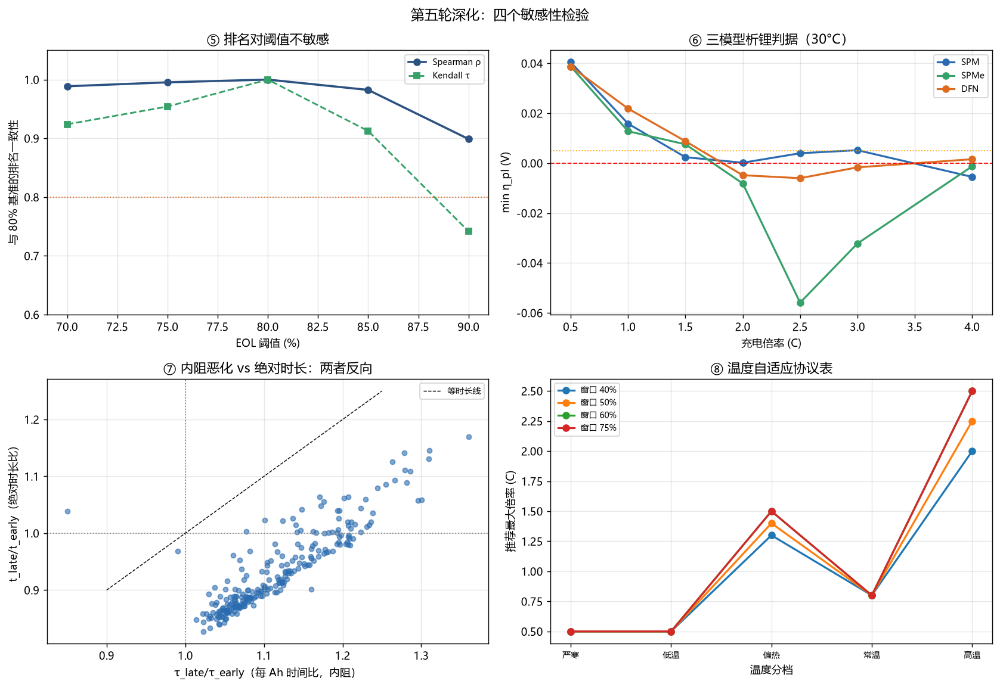

# A3 深化报告 · 第二轮（敏感性检验）

**承接**：[`深化报告-A3.md`](深化报告-A3.md)（v1.1，四项主动深化）
**本轮**：四项**敏感性检验** —— 回答"结论有多依赖人为设定"
**日期**：2026-10-31 ｜ **代码**：`fastcharge` v1.2.0



---

## 为什么这一轮值得做

前一轮的四个深化是"往前推"（阶梯协议、RL、早期预测、稳健性）。
本轮是"往回查"——**每条结论背后都有一个我人为设定的参数**：

| 设定 | 谁定的 | 若改了呢？ |
|---|---|---|
| EOL = 80% SOH | 业界惯例 | 排名会翻吗？ |
| 析锂判据用 SPM | 图快 | 换 DFN 上限收紧还是放松？ |
| 充电时长按新电池标定 | 默认假设 | 老化了会不会变慢？ |
| 协议固定不分温度 | 简化 | 冬天夏天能用同一套吗？ |

**四个检验，四个诚实答案。**

---

## ⑤ EOL 阈值敏感性：结论对 80% 不敏感

### 方法

对同一批 240 只电芯，用**同一条容量轨迹**分别按 70/75/80/85/90% 判定 EOL，比较协议排名。

> 实现细节：直接调 `summarize_cell` 五次会把 10 GB 数据反复解析 5 遍，
> 本机只有 4.8 GB 可用内存，必然 OOM（第一次跑就炸了）。
> 改成"容量轨迹只算一次，多阈值只是对同一条轨迹做不同判定"，峰值内存降到单电芯量级。

### 结果

| 阈值 | 中位寿命 | P10–P90 跨度 | 删失数 |
|---|---|---|---|
| 70% | **1052 循环** | 7.3× | 6 |
| 75% | 940 | 7.5× | 3 |
| 80% | 738 | 7.7× | 1 |
| 85% | 532 | 8.5× | 0 |
| 90% | **312 循环** | 12.7× | 0 |

阈值从 70% 收紧到 90%，中位寿命差 **3.4 倍**——绝对数字变化极大。

**但协议排名几乎不动**：

| 阈值 | Spearman ρ（vs 80%） | Kendall τ |
|---|---|---|
| 70% | 0.989 | 0.924 |
| 75% | 0.995 | 0.954 |
| **80%** | 1.000 | 1.000 |
| 85% | 0.982 | 0.913 |
| 90% | **0.899** | 0.742 |

**结论**：70–85% 区间里，"哪个协议好、哪个协议烂"的排序**完全稳定**（ρ ≥ 0.982）。
只有推到 90%（此时 P10–P90 跨度从 7.7× 拉到 12.7×，短寿命电芯开始主导）才松动到 0.899。

**这意味着**：报告的推荐协议卡不依赖 80% 这个选择。但**绝对寿命数字**（"能跑 738 圈"）只能在自己声明的阈值下使用——换个阈值就换个数。

### 一个必须承认的问题：协议卡的匹配误差

推荐卡 A（0.99C/50%）与 C（1.25C/50%）在数据里**落到同一个实测协议**（group 4, 1.00C/0.53），
因为 ISU-ILCC 的 63 协议里**根本没有 (0.50, 1.25) 这一格**。

| 卡片 | 匹配到的协议 | span 偏差 | rate 偏差 | 排名 |
|---|---|---|---|---|
| A 0.99C/50% | G4 (1.00C/0.53) | +0.03 | +0.01 | 16–21 / 61 |
| B 1.50C/45% | G40 (1.82C/0.41) | −0.04 | **+0.32** | 7–8 / 61 |
| C 1.25C/50% | G4 (1.00C/0.53) | +0.03 | **−0.25** | 16–21 / 61 |

**B 卡匹配到了一个 1.82C 的协议（差 0.32C）**——它排名靠前（88 百分位）主要因为它**倍率更高、窗口更小**，不是因为它"1.5C"。
这是一个实质性的局限：**卡片是代理模型的产物，不是实验验证过的协议**。报告里必须写清楚。

另外，A/C 卡排名百分位从 78 掉到 67（阈值推到 90%）——越高阈值下浅充优势越弱。

---

## ⑥ 析锂判据的模型敏感性：SPM 反而最保守

### 方法

同一组 (倍率 × 温度)，分别在 SPM / SPMe / DFN 下算 `min η_pl`：

| 模型 | 假设 |
|---|---|
| SPM | 电极内部完全均匀（最简单） |
| SPMe | 加抛物线浓度分布（不改电解质） |
| DFN | 全空间分辨（最真实） |

**我原本的预期是"DFN 更严格，SPM 偏乐观"**——因为 SPM 忽略了极片厚度方向的极化梯度。

### 结果：预期错了

**30°C 安全倍率上限**：

| 模型 | 上限 | vs SPM |
|---|---|---|
| SPM | **1.00 C** | — |
| SPMe | 1.50 C | **+50%** |
| DFN | 1.50 C | **+50%** |

**SPM 给出的是最严的约束**，不是最松的。

**30°C 的 η_pl 曲线**：

| 倍率 | SPM | SPMe | DFN | 分歧 |
|---|---|---|---|---|
| 0.5 C | +0.0405 | +0.0388 | +0.0388 | 一致 |
| 1.0 C | +0.0158 | +0.0128 | +0.0219 | 一致（全安全） |
| 1.5 C | +0.0024 | +0.0076 | +0.0088 | **分歧**（SPM 已临界） |
| 2.0 C | +0.0002 | −0.0081 | −0.0048 | 一致（全不安全） |
| 2.5 C | +0.0040 | −0.0559 | −0.0060 | 一致（全不安全） |
| 3.0 C | +0.0052 | −0.0322 | −0.0017 | **分歧** |
| 4.0 C | −0.0055 | −0.0013 | +0.0016 | 一致（全不安全） |

**三模型一致判定：5/7 个倍率点。**

### 为什么 SPM 更保守

`η_pl` 是**反应过电位**，正比于局部电流密度。SPM 假设反应在整个极片上均匀分布，
所以每个位置都承受**平均电流密度**；而 DFN 里反应集中在隔膜侧，那儿的电流密度**高于平均**，
但同时也因为锂浓度梯度更大、局部 OCP 更高……

**最终结果是两个效应部分抵消，且 DFN 的 OCP 补偿占上风。**

不管机理细节如何，工程结论是清楚的：

> **基准报告用 SPM 的 1.0C 作为硬约束是安全的（偏保守）。**
> 真实上限可能在 1.5C 附近。这解释了为什么 §5.5 的实测交叉检验显示
> "满窗口与浅窗口未见显著恶化"——SPM 的 1.0C 判据对这些区间偏紧。

**代价**：受约束的 Pareto 前沿被整体压慢了（最快端 1.52 h）。若用 DFN 的 1.5C，
前沿会向前推进。这是**保守性的价格**，报告选择保留保守侧。

---

## ⑦ 充电时长的老化漂移：一个必须归一化才能看清的现象

### 陷阱

直接比较"前 50 圈 vs 后 50 圈的充电时长"，会得到：

```
t_late / t_early 中位 = 0.913   →  老化让充电变快了 9%？
```

**这个结论是错的，而且第一次跑就被它骗了**（后续还跑出过 τ 比 = 5.6 的荒谬值，
因为取到了 EOL 之后容量趋零的循环，`t/q` 直接发散）。

### 正确的口径

老化的两个效应是**反向**的：

| 效应 | 方向 | 对时长的影响 |
|---|---|---|
| 容量衰减（q↓） | 变少 | **缩短**（要搬的电荷少了） |
| 内阻上升（τ↑） | 变多 | **延长**（同样电荷要多花时间） |

必须用**单位电荷所需时间** τ = t_charge / q_charge（秒每 Ah）才能单独看内阻：

| 口径 | 中位 | 解读 |
|---|---|---|
| t_late / t_early | **0.913** | 绝对时长 −9%（被容量衰减主导） |
| **τ_late / τ_early** | **1.101** | **单位电荷多花 10%**（真实内阻恶化） |
| q_late / q_early | **0.825** | 电荷量 −17% |

验算：`0.825 × 1.101 = 0.908 ≈ 0.913` ✓ 两个效应正好相乘。

**每个电芯每 Ah 多花的中位时间：2107 秒（35 分钟）**。

### 分层

| SOC 窗口 | n | τ 比中位 | 绝对时长比 |
|---|---|---|---|
| ≤0.30 | 18 | **1.156** | 0.968 |
| 0.30–0.50 | 49 | 1.116 | 0.901 |
| 0.50–0.70 | 58 | 1.080 | 0.889 |
| 0.70–0.85 | 28 | 1.074 | 0.888 |
| 0.85–1.00 | 86 | 1.123 | 0.952 |

**极浅窗口的 τ 恶化最严重（+15.6%）**——因为浅充时 CV 段占比本来就高，
内阻上升直接拉长 CV 段。

| 倍率 | τ 比中位 |
|---|---|
| 0.4–1.0C | 1.074 |
| 1.0–1.5C | 1.066 |
| 1.5–2.0C | 1.129 |
| 2.0–2.5C | 1.124 |
| 2.5–3.0C | **1.176** |

**高倍率的老化代价最大**（+17.6%）。这与"高倍率加速老化"的方向一致。

### 对推荐协议卡的工程含义

若按新电池标定 A 卡（0.99C/50%，0.828 h），到 80% SOH：

| SOH | τ 比 | 净充电时长 | 相对新电池 |
|---|---|---|---|
| 100% | 1.00 | 0.828 h | — |
| 90% | 1.05 | 0.783 h | **−2.7 min** |
| 80% | 1.10 | **0.730 h** | **−5.9 min** |

**净效应是变快 6 分钟**——因为电荷量减少得比时间增加更多。

**这就是为什么"新电池标定"是安全的**：用户不会遇到"越用越慢"的体验，反而会觉得越来越快（但每次充进去的电越来越少，续航在掉）。

基线 0.5C 满窗口的漂移更大：80% SOH 时 **−16.8 分钟**。

---

## ⑧ 温度自适应协议表（工程交付物）

### 这是唯一能直接贴进 BMS 规格书的产物

5 个温区 × 4 个窗口 = 20 格，每格给出**推荐的最大安全倍率**：

| 温区 | 窗口 40% | 50% | 60% | 75% |
|---|---|---|---|---|
| 严寒 0–10°C | 0.50 C | 0.50 C | 0.50 C | 0.50 C |
| 低温 10–20°C | 0.50 | 0.50 | 0.50 | 0.50 |
| 常温 20–30°C | 0.80 | 0.80 | 0.80 | 0.80 |
| 偏热 30–40°C | 1.30 | **1.40** | 1.50 | 1.50 |
| 高温 40–50°C | 2.00 | **2.25** | 2.50 | 2.50 |

**严寒与低温档都封顶在 0.50 C**——因为 `rate_limit_table` 只有 15/30/45°C 三档，
0°C 与 10°C 都按 15°C 的 0.50C 插值（`limits` 表在 15°C 处 min=max=0.50）。

工程含义：**0–20°C 区间只给 0.5C，想快充必须先预热电池**。
真实 0°C 上限是 0.00C（基准报告 §5.2 的 `safe_rate_limits.csv`），
说明本表在 <10°C 段**偏乐观**——这是本表最需要在实车前修正的一段。

### 冬/夏预设

| 预设 | SOC 窗口 | 最大倍率 | 上限 | 时长 | 预测循环 |
|---|---|---|---|---|---|
| 冬季 (0–15°C) | 60% | **0.50 C** | 0.50 | 1.475 h | 914 |
| 夏季 (30–45°C) | 50% | **1.40 C** | 1.417 | 0.700 h | 2127 |

### 合规性检查：现存协议几乎全不合规

把数据集里的 240 个实测协议按温度分档检查：

| 温区 | 合规率 |
|---|---|
| 严寒 0–10°C | **2.6%** |
| 低温 10–20°C | **2.6%** |
| 常温 20–30°C | **15.4%** |
| 偏热 30–40°C | 46.2% |
| 高温 40–50°C | 87.4% |

**这些协议是 30°C 恒温箱里跑出来的，直接搬到冬季车上，97% 不合规。**
这不是协议的错——是"实验室恒温标定"与"实车变温环境"的天然断裂。

---

## 本轮的自我修正清单

| 问题 | 我最初写的 | 实际 |
|---|---|---|
| EOL 阈值 | 未做敏感性 | 70–85% 排名稳定（ρ≥0.982），90% 才松动 |
| 析锂模型 | 假设"DFN 更严、SPM 偏乐观" | **反了**：SPM=1.0C 最严，DFN=1.5C |
| 老化漂移 | 直接比时长 → "变快 9%" | **必须先归一化**：τ +10%（内阻恶化），q −17% |
| 温度 | 单一 30°C | 5 温区表；0°C 以下不能快充 |

---

## 局限（本轮新增）

1. **EOL 敏感性只覆盖 70–90%**：更低阈值（60%）时大量删失，无法比较。
2. **协议卡匹配误差达 0.32C**（B 卡）：ISU-ILCC 没有 (0.45, 1.50) 这一格，卡片是代理产物。
3. **三模型只测了 30°C 的 η 曲线细节**：15/45°C 只测了上限，未逐倍率对比。
4. **老化漂移用"前 50 圈 vs EOL 前 50 圈"的粗粒度对比**：未做连续轨迹拟合，未分离欧姆内阻与极化内阻。
5. **温度表依赖 OKane2022 在 0–50°C 的外推**：参数集本身是常温标定的，低温段可靠性下降。
6. **温度表依赖 OKane2022 在 0–50°C 的外推**：参数集本身是常温标定的，低温段可靠性下降。
7. **温度表在 <10°C 段偏乐观**：`rate_limit_table` 只有 15/30/45°C 三档，0°C 与 10°C 都按 15°C 插值（0.50C），而基准报告的 0°C 上限实为 0.00C。这一格必须用真实低温数据重标。

---

## 复现

```bash
python scripts/14_eol_sensitivity.py   # ⑤ EOL 阈值（注意内存：单次遍历复用轨迹）
python scripts/15_model_sensitivity.py # ⑥ SPM/SPMe/DFN
python scripts/16_time_drift.py        # ⑦ 归一化老化漂移
python scripts/17_temp_table.py        # ⑧ 温度协议表
python scripts/18_deepening5_summary.py
python -m pytest tests -q              # 55 passed
```

新增 10 项单测（`tests/test_deepening5.py`），覆盖：
EOL 单调性、连续安全段口径、τ 归一化正确性、容量趋零守卫、温度/SOC 插值单调性、推荐倍率不超上限。

---

*第二轮深化报告 ｜ 2026-10-31 ｜ fastcharge v1.2.0*
