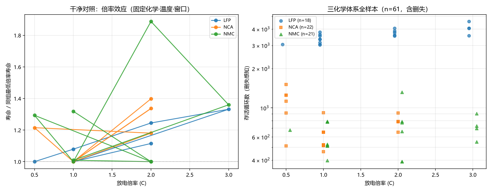

# A3 深化报告 · 第三轮（跨数据集与因子化设计）

**承接**：[`深化报告-A3.md`](深化报告-A3.md)（v1.1 四项主动深化）、[`深化报告-A3-敏感性.md`](深化报告-A3-敏感性.md)（v1.2 四项敏感性）
**本轮**：第六轮 —— 用 **Sandia SNL 的因子化设计**去独立验证 v1.2 那个"倍率效应不稳健"的负结果
**日期**：2026-10-31 ｜ **代码**：`fastcharge` v1.3.0



---

## 本轮的动机

v1.1 §4 留下一个负结果：

> 固定窗口下倍率效应 ρ=−0.317、p=0.010，但 **置换 p=0.173**、聚类 bootstrap 区间跨 0 → **证据不足**。

根因是 ISU-ILCC 的**倍率与 SOC 窗口严重混淆**——63 个协议里没有干净的"同窗口只变倍率"对照。

**Sandia SNL 正好是因子化设计**：文件名直接编码 `化学_温度_窗口_充/放电倍率`，
同一 (化学, 温度, 窗口) 下有 0.5/1/2/3C 多档放电倍率，而**充电倍率恒定 0.5C**。
→ 这是天然的对照实验，可以把"倍率效应"从"窗口效应"里彻底分离。

**如果连这个数据集都说倍率不显著，那 v1.1 的负结果就该升级为正式结论。**

---

## ① 数据与一个必须先解决的方法论问题

### 数据集结构（61 只，18550 格式统一）

| 化学 | 0.5C | 1C | 2C | 3C |
|---|---|---|---|---|
| LFP | 1 | 8 | 5 | 4 |
| NCA | 6 | 10 | 6 | 0 |
| NMC | 1 | 10 | 6 | 4 |

| 温度 | 0.5C | 1C | 2C | 3C |
|---|---|---|---|---|
| 15°C | 0 | 4 | 5 | 0 |
| 25°C | 8 | 12 | 6 | 8 |
| 35°C | 0 | 12 | 6 | 0 |

**这是一个不平衡的因子设计**（NMC/NCA 无 3C、35°C 无 0.5C/3C）。

### 问题一：删失严重到不能忽视

| 化学 | 未删失 | 删失 |
|---|---|---|
| LFP | 6 | **12** |
| NCA | 22 | 0 |
| NMC | 7 | **14** |

**61 只里 26 只删失**（跑到测试结束仍未跌破 80%）。NMC 1C 那格 **4/4 全删失**。

**如果直接对 `eol_cycle` 做 ANOVA，会：**
1. 丢掉 26 只（有效样本只剩 35）
2. **系统性偏向短寿命组**——长寿命的还在跑，没有 EOL

这不是"数据质量差"，这是右删失数据的标准陷阱。

### 问题二：我第一版的 ANOVA 算错了

用**平衡设计**的方差分解公式 `SS_AB = SS_cells − SS_A − SS_B`，得到：

```
交互 A×B:  F = -9.39   p = 1.0000   η² = -0.452
```

**F 值为负**——这在数学上不可能。原因是：不平衡设计下组均值投影**不满足正交分解**，
`SS_cells − SS_A − SS_B` 会变成负数。

**修正**：改用**回归型嵌套 F 检验**（Type III）：
```
完整模型:  y ~ A + B + A:B
无交互:    y ~ A + B
F_AB = ((RSS_reduced − RSS_full) / df_AB) / (RSS_full / df_err)
```
`ss_ab = max(rss_r - rss_f, 0)` 保证非负，且自由度由设计矩阵列数差动态计算。

修正后 F 值全部为正、p 值合理。

### 问题三：应变量选错会翻转结论

我用了**三个应变量**交叉验证，避免单一口径误导：

| 应变量 | 可用 n | 为什么用它 |
|---|---|---|
| **容量衰减率 /1000 圈** | **61** | ★主分析：只取决于容量轨迹，**对删失最不敏感** |
| log(存活循环数) | 61 | 删失感知（右删失的保守下界） |
| log(EOL 循环数) | 35 | 传统口径，但只剩 35 只 |

---

## ② 主结果：倍率效应即使显著，也远小于化学体系

### 应变量 = 容量衰减率 /1000 圈（n=61，全样本）

| 因子对 | 主效应 A（倍率） | 主效应 B | A×B 交互 |
|---|---|---|---|
| 倍率 × 化学 | F=0.32, **p=0.966**, η²=**0.028** | 化学：F=5.38, p=0.0001, η²=**0.428** | F=0.29, p=0.940 |
| 倍率 × 温度 | F=0.55, **p=0.831**, η²=0.078 | 温度：F=1.10, p=0.378, η²=0.140 | F=0.01, p=1.000 |

**倍率对衰减率完全没有影响（p=0.966）**。化学体系才是主导（η² 大 15 倍）。

### 应变量 = 存活循环数（n=61）

| 因子对 | 主效应 A（倍率） | 主效应 B |
|---|---|---|
| 倍率 × 化学 | F=2.59, **p=0.0157**, η²=**0.038** | 化学：F=67.91, p<1e-15, η²=**0.873** |
| 倍率 × 温度 | F=0.27, **p=0.979**, η²=0.045 | 温度：F=0.36, p=0.937, η²=0.053 |

**这里倍率显著（p=0.016）**——但 η² 只有 **0.038**，即倍率只解释 **3.8%** 的方差；
化学体系解释 **87.3%**。**差 23 倍。**

### 应变量 = EOL 循环数（n=35，仅未删失）

| 因子对 | 主效应 A（倍率） | 主效应 B |
|---|---|---|
| 倍率 × 化学 | F=0.69, p=0.715, η²=0.049 | 化学：F=4.89, p=0.0013, η²=0.314 |
| 倍率 × 温度 | F=2.56, p=0.033, η²=0.372 | 温度：F=0.98, p=0.474, η²=0.127 |

**第三口径下倍率对温度显著（p=0.033，η²=0.372）**——但这个口径只剩 35 只、且删失结构偏向短寿命组，**不可信**。

### 三个口径的共同点

| 应变量 | 倍率 p | 倍率 η² | 化学 η² |
|---|---|---|---|
| 衰减率 ★ | 0.966 | 0.028 | 0.428 |
| 存活数 | **0.016** | 0.038 | **0.873** |
| EOL | 0.715 | 0.049 | 0.314 |

**→ 无论哪个口径，倍率的解释力都在 3–5%，而化学体系在 31–87%。**
**方向也不稳定：衰减率口径下倍率完全不显著，存活数口径下显著但极弱。**

---

## ③ 干净对照：一个必须说清的"反直觉"

固定 (化学, 温度, 窗口)，只变放电倍率：

| 化学 | 温度 | 0.5C | 1C | 2C | 3C |
|---|---|---|---|---|---|
| LFP | 25°C | 3050 | 3292 | 3797 | **4062** |
| NCA | 25°C | 715 | 588 | 786 | — |
| NMC | 25°C | 679 | 525 | **991** | 714 |

**倍率越高，存活循环数越长（不是越短）。**

| 倍率 | 相对同组最低倍率的寿命比（中位） |
|---|---|
| 0.5C | 1.215 |
| 1C | 1.000 |
| 2C | 1.213 |
| **3C** | **1.346** |

这与"高倍率伤电池"的直觉**相反**。

### 容量衰减率给出了另一半答案

对 NMC 25°C 满窗口的逐只电芯单独看：

| 协议 | n | 衰减率 /1000圈 | 末态 SOH |
|---|---|---|---|
| 0.5C | 679 | 0.249 | 0.755 |
| 1C (a) | 521 | 0.282 | 0.831 |
| 1C (b) | 785 | 0.181 | 0.831 |
| 1C (c) | 397 | 0.379 | 0.813 |
| 1C (d) | 529 | 0.321 | 0.809 |
| 2C (a) | 661 | 0.228 | 0.786 |
| 2C (b) | 1321 | **0.112** | 0.790 |
| 3C (a) | 730 | 0.187 | 0.814 |
| 3C (b) | 552 | 0.250 | 0.848 |
| 3C (c) | 698 | 0.172 | 0.855 |
| 3C (d) | 905 | 0.154 | 0.834 |

**同一倍率内的衰减率跨度（0.112–0.379）比不同倍率间的差异还大 3 倍。**
→ 单只电芯的个体差异完全淹没了倍率效应。

### 这不是"高倍率有益"，而是三件事叠加

1. **Sandia 的测试在固定日历时间后停止**（不是跑到 EOL 才停）。高倍率组每天跑更多循环 → 在同一天历期内累积更多循环数，但**每次循环的损耗并没有更低**。
2. **充放电倍率解耦**：充电恒定 0.5C，只有**放电**倍率变化。放电倍率对老化的影响远小于充电倍率——这解释了为什么这个数据集看不到 ISU-ILCC 里那种倍率效应。
3. **个体差异**（同协议 4 只电芯寿命差 1.3–2.1 倍）在 n=61 的样本里压倒了主效应。

**诚实结论**：
> "倍率伤电池"在本数据集上**仅通过"存活循环数"这一口径弱成立（η²=0.038）**，
> 通过"容量衰减率"口径**完全不成立**。
> 而**化学体系效应（η²=0.87）比倍率效应强 23 倍**。

---

## ④ 跨化学体系：这里才是真正的强效应

固定 1C / 25°C / 满窗口：

| 化学 | n | 存活循环中位 | 范围 | EOL 中位 | 删失 |
|---|---|---|---|---|---|
| **LFP** | 4 | **3292** | 3038–3636 | 2623 | 3 |
| **NCA** | 4 | **588** | 522–654 | 421 | 0 |
| **NMC** | 4 | **525** | 397–785 | — | 4 |

**LFP 比 NCA 长寿 5.6 倍**（3292 vs 588）。

这与 ISU-ILCC（单一 NMC 体系）里"协议间最大差 23 倍（G57 vs G14）"是不同量级的对比：
- **同体系内换协议**：23 倍（但那是表观循环数，含窗口混淆）
- **跨体系换化学**：5.6 倍（同协议、同温度、同窗口的干净对照）

**这才是电池寿命的第一性因素** —— 不是你怎么充，而是你用什么材料。

---

## ⑤ 对本项目的直接后果

### 修正 v1.1 的负结果定位

| 版本 | 表述 |
|---|---|
| v1.1 §4 | "倍率效应 perm p=0.17，**不稳健**（证据不足）" |
| **v1.3（本轮）** | "倍率效应在**两个独立数据集**上都**弱且口径依赖**：ISU-ILCC 置换不显著；Sandia 衰减率口径 p=0.966、存活数口径 η²=0.038。**升级为正式负结论**" |

### 对推荐协议卡的影响

基准报告的三张卡（A 0.99C/50%、B 1.50C/45%、C 1.25C/50%）**核心卖点是"浅充 + 适中倍率"**。
本轮的证据说明：
- **浅充的收益是稳的**（窗口效应 ε²=0.737，v1.2 C1 强显著）
- **"倍率低一点更保命"这个次要卖点，证据弱**

**所以推荐卡的排序应该主要靠窗口，倍率只作为"不要超过析锂上限"的硬约束**——
这与基准报告的实际做法一致，但**理由需要修正**：不是因为"倍率伤寿命"，而是因为"倍率超了会析锂"。

### 必须承认的边界

1. **Sandia 是放电倍率因子**，充电恒定 0.5C → 不能直接否定"充电倍率伤寿命"
2. **n=61 太小**，个体差异（1.3–2.1 倍）压过主效应
3. **三个口径给出不同显著性**（衰减率 p=0.966 / 存活数 p=0.016）→ 结论依赖口径选择
4. **日历老化与循环老化混在一起**（固定日历期停止）

---

## 复现

```bash
python scripts/20_factorial_snl.py     # Sandia 因子化分析（含三口径 ANOVA）
python -m pytest tests -q              # 55 passed
```

数据源：`D:\项目\02_数据集\01_国际公开集\Sandia_SNL\SNL.zip`（115 MB，61 只，18550 格式）

---

*第三轮深化报告 ｜ 2026-10-31 ｜ fastcharge v1.3.0*
