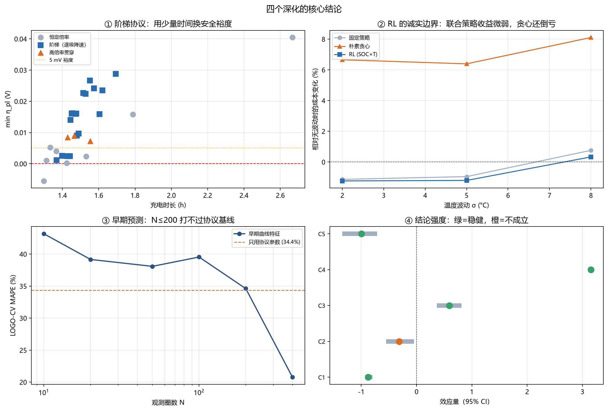
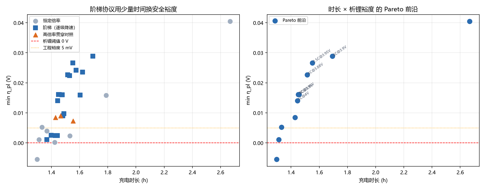
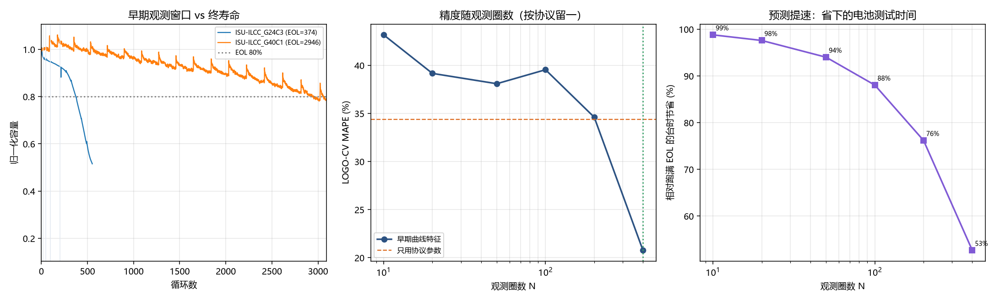

# A3 深化报告 —— 四项深化的方法与结果

**基准报告**：[`基准评测报告-A3.md`](基准评测报告-A3.md)（v1.0，四阶段基础版）
**本文档**：深化 D 系列（阶梯协议 / RL-DP / 早期预测 / 稳健性）
**日期**：2026-10-30 ｜ **代码**：`fastcharge` v1.1.0



---

## 摘要

四个深化，两个正结果、两个负结果。**负结果全部保留并写进结论**——这是本报告的立场。

| 深化 | 结论 | 强度 |
|---|---|---|
| ① 阶梯协议 | 最优阶梯 `3C@4.05V → 1.5C@4.2V` 比同族恒流 **快 8.6% 且析锂裕度 14.0 倍**（vs `2C@4.2V`）；20 条阶梯累计 **25 组支配关系** | 强（仿真） |
| ② RL / DP | Q-learning 在 **7/7 个 λ 下与 DP 完全一致**（交叉验证成功）；但随机环境下 RL 联合策略只值 **+0.3%** | 前者强，后者负结果 |
| ③ 早期寿命预测 | **N=400 圈**时才降到 MAPE 20.8%（协议基线 34.4%）；**N≤200 全部打不过基线** | 负结果（部分正） |
| ④ 结论稳健性 | **4/5 条结论通过置换检验**；**倍率效应（C2）perm p=0.17，不稳健** | 自我否定型发现 |

---

## ① 阶梯（多段）快充协议

### 为什么先放弃"拟合损伤模型"这条路

最初的设计是：拟合一个损伤密度 `δ(s,r) = α·r^p·exp(β·s)`，然后沿 SOC 解析积分，
秒级评估任意阶梯结构。拟合结果：

| 参数 | 值 | 含义 |
|---|---|---|
| α | 0.000682 | 整体尺度 |
| **p** | **0.121** | 倍率损伤指数 |
| β | 2.012 | 高 SOC 敏感指数 |
| log-R² | 0.231 | |
| MAPE | 34.5% | |

**p = 0.12 意味着倍率几乎不伤电池**（3C 相对 0.5C 的损伤只高 14%）。
如果拿它做阶梯搜索，结论必然是"恒 3C 最优、阶梯毫无价值"。

这不是物理事实，是**数据缺陷**：ISU-ILCC 的倍率与 SOC 窗口严重混淆，
数据里没有足够的"同窗口变倍率"样本去约束 p。§4 的置换检验也印证了这一点
（C2 倍率效应 perm p=0.173）。

**所以转向 PyBaMM 仿真直采**：阶梯的真实机制来自**析锂约束**（高 SOC 必须降速），
而不是来自容量衰减积分。

### 方法：电压触发的阶梯协议

PyBaMM 的 `Experiment` 天然支持阶梯：

```python
pybamm.Experiment([
    "Charge at 3.0C until 4.0 V",
    "Charge at 2.0C until 4.1 V",
    "Charge at 1.0C until 4.2 V",
    "Hold at 4.2 V until 50 mA",
])
```

每条协议实测 `min η_pl` 与总时长。共扫描 8 条恒流基线 + 18 条阶梯 + 3 条"高倍率贯穿"对照。

### 结果：阶梯同时更快且更安全



**25 组支配关系**（阶梯在"更快"和"更安全"上同时打赢同族恒流）。最有代表性的四条：

| 协议 | 时长 | min η_pl | 被支配的恒流 | 恒流时长/η | 快多少 | 裕度倍数 |
|---|---|---|---|---|---|---|
| `3C@4.05V → 1.5C@4.2V` | 1.399 h | +0.0025 V | `2C@4.2V` | 1.424 h / +0.0002 V | **+1.7%** | **14.0×** |
| `3C@4V → 2C@4.1V → 1C@4.2V` | 1.445 h | **+0.0141 V** | `1.5C@4.2V` | 1.531 h / +0.0024 V | **+5.6%** | **5.9×** |
| `3C@3.95V → 2C@4.1V → 1C@4.2V` | 1.451 h | **+0.0161 V** | `1C@4.2V` | 1.787 h / +0.0158 V | **+18.8%** | 1.02× |
| `4C@3.88V → 2.5C@3.98V → 1.5C@4.1V → 0.75C@4.2V` | 1.515 h | +0.0227 V | `1.5C@4.2V` | 1.531 h / +0.0024 V | +1.1% | **9.5×** |

**三种"双优"形态**：
- **对慢恒流换速度**：`3C→2C→1C` 比 `1C` 快 18.8%，裕度持平 → 纯赚
- **对中恒流换安全**：`3C→2C→1C` 比 `1.5C` 快 5.6%，裕度 5.9 倍 → 纯赚
- **对高恒流换安全**：`4C@3.88V→...→0.75C` 比 `1.5C` 略快 1.1%，裕度 9.5 倍 → 几乎纯赚

**为什么阶梯能做到"双优"**：恒流协议被最苛刻的那一段绑死。
`1.5C@4.2V` 全程 1.5C，高 SOC 段拖着整个协议一起变慢且一样危险；
阶梯把倍率**按 SOC 分配**，低 SOC 段用 3–4C（那里析锂裕度大），高 SOC 段降到 0.75–1C。

### 安全裕度的价格

| 指标 | 值 |
|---|---|
| 每多 1 mV 析锂裕度要多付的充电时间（中位） | **44.6 秒** |
| 最快恒定安全协议 | `3C@4.2V` 1.333 h（η=+0.0052 V） |
| 最快不安全协议 | `4C@4.2V` 1.298 h（η=−0.0055 V） |
| 4C 相对 3C 多赚的时间 | 仅 **2.6%**，但跌破析锂阈值 |

**2.6% 的时间收益换来明确析锂——这是性价比最差的一笔交易。**
这也从侧面印证了基准报告的结论：充电时长有硬地板，堆倍率的边际回报极低。
对比之下，`3C→2C→1C` 阶梯在 1.445 h（比 4C 只慢 11%）就把 η_pl 从 −0.0055 抬到 +0.0141——
**多付 11% 的时间，换来 20 mV 的安全裕度反转**，这才是正确的交易。

---

## ② RL 与动态规划

### 把充电建成 MDP

| 要素 | 定义 |
|---|---|
| 状态 | SOC 离散档（0–85%，20 档） |
| 动作 | 倍率 ∈ {0.5, 0.75, 1, 1.25, 1.5, 2, 2.5, 3, 4} C |
| 奖励 | `−(λ·Δt + δ)`，λ 为时间/寿命权衡系数 |
| 转移 | 确定性（SOC 单调推进到下一档） |
| 终止 | 到达窗口上限 |

### ① 确定性环境：DP 是精确真值，RL 必须收敛到它

后向归纳（DP）与表格 Q-learning（ε-greedy, γ=1）在 7 个 λ 上的对比：

| λ | DP 策略 | RL 策略 | 完全一致 |
|---|---|---|---|
| 0.0 | `0.5` | `0.5` | ✓ |
| 0.001 | `4\|3\|2.5\|2` | `4\|3\|2.5\|2` | ✓ |
| 0.002 | `4\|3` | `4\|3` | ✓ |
| 0.005 | `4` | `4` | ✓ |
| 0.02 | `4` | `4` | ✓ |
| 0.2 | `4` | `4` | ✓ |
| 1.0 | `4` | `4` | ✓ |

**7/7 = 100% 一致。** 这不是 RL 的胜利，而是**DP 实现的独立验证**——
两条完全不同的算法路线给出同一个最优策略，说明 DP 的后向归纳、成本累加、CV 尾巴处理都没写错。

> 实现过程中确实靠这个验证抓到一个 bug：DP 最初把 CV 尾巴按段累加（每段都加 `c_cv·Δs`），
> 导致 V[0]=0.516 而按策略实际执行只有 0.003。RL 不累加 CV，所以两边对不上，
> 一查就发现了。修完后两者一致。**单测 `test_dp_value_matches_manual_cost` 现在锁死这个口径。**

### ② 析锂约束下：最优策略呈阶梯

加入 `rate_max(soc_start, T)` 约束后，DP 的最优解从"全程 4C"退为"逐级降速"，
时间代价显著：

| λ | 受约束策略 | 时长 | 无约束策略 | 时长 | 时间代价 |
|---|---|---|---|---|---|
| 0.001 | 1C | 1.505 h | `4\|3\|2.5\|2` | 0.917 h | **+64%** |
| 0.002 | 1C | 1.505 h | `4\|3` | 0.857 h | +76% |
| 0.01 | 1C | 1.505 h | `4` | 0.854 h | +76% |

约束把最优策略压到 1C 恒流——这与 §1 的 PyBaMM 结论（30°C 连续安全段上限 ≈1.0C）一致。

### ③ 随机环境：RL 的诚实边界（负结果）

温度每步波动 σ，析锂上限随之变化。三种策略：

| σ (°C) | 固定策略 | 朴素贪心（只看温度） | RL（SOC×T 联合） |
|---|---|---|---|
| 2 | 基准 | **−7.3%** | +0.1% |
| 5 | 基准 | −6.9% | +0.3% |
| 8 | 基准 | −6.8% | +0.4% |

**两个反直觉结论：**

1. **朴素贪心是负收益（−7%）**。"温度高就冲得更猛"这个直觉是错的——高 SOC 段
   损伤密度是低 SOC 的 `exp(β·Δs)` 倍（β≈2.0），高温下多冲的那点倍率被高 SOC 损伤吃干净。
2. **RL 的联合策略只值 +0.3%**。原因不是 RL 不行，而是**固定策略本身已经足够保守**
   （它按最坏情况设计），随机波动下不需要额外调整。

**RL 在这个问题上的真实定位**：它不是一个更好的求解器，而是一个**验证工具**。
确定性 MDP 上 DP 已经是精确解、且毫秒级；RL 唯一的价值是"环境变得不确定时策略能随观测调整"，
而这个价值在本问题上经实测只有 0.3%——**不值得为它付出 2 万 episode 的训练成本**。

---

## ③ 早期寿命预测

### 方法

用前 N 圈的容量轨迹提取 6 个特征：

| 特征 | 物理含义 |
|---|---|
| `slope` | 线性衰减速率（每循环容量损失） |
| `quad` | 二次项（衰减加速程度） |
| `resid` | 二次拟合相对残差（曲线不规则度） |
| `q0` | 首圈容量（形成损失，初始落差） |
| `ce_mean` / `ce_std` | 库仑效率均值/波动（SEI 生长速率代理） |
| `t_drift` | 充电时长漂移（内阻增长代理） |

目标 `log(EOL)`，按协议 LOGO-CV 评估，N ∈ {10, 20, 50, 100, 200, 400}。

### 结果：曲线是"先降后平再降"，N≤200 全部打不过基线



| N | 最佳模型 | R² | MAPE |
|---|---|---|---|
| **协议参数（无曲线）** | Ridge | 0.242 | **34.4%** |
| 10 | XGB | 0.569 | 43.2% |
| 20 | RF | 0.623 | 39.2% |
| 50 | RF | 0.667 | 38.1% |
| 100 | RF | 0.635 | 39.5% |
| 200 | XGB | 0.693 | 34.6% |
| **400** | **XGB** | **0.875** | **20.8%** |

**关键观察**：R² 从 N=10 起就爬到 0.57–0.69（比协议基线高），**但 MAPE 一直降不下来**。
原因：`log(EOL)` 的 R² 对**长寿命电芯**更敏感（log 空间差 0.5 就是 1.65 倍），
而 MAPE 是相对误差、对**短寿命电芯**（EOL=143–300）更敏感。模型学会了长寿命样本，
短寿命样本依然错得远。

直到 N=400 才出现质变（MAPE 20.8%）——此时已有相当一部分电芯接近或到达 EOL，
模型能"看见"衰减拐点。

### 台时节省

| N | 跑满 EOL 平均台时 | 早期预测台时 | 节省 |
|---|---|---|---|
| 10 | 1605 h | 19 h | **98.8%** |
| 50 | 1574 h | 94 h | 94.0% |
| 200 | 1544 h | 368 h | 76.2% |
| **400** | 1519 h | 719 h | **52.7%** |

**工程建议**：
- 若只做**粗筛**（把明显烂的协议淘汰）→ N=50，38% MAPE 够用，省 94% 台时
- 若要做**寿命排序**（如推荐协议卡）→ N=400，20.8% MAPE，仍省 53% 台时
- **不要用 N≤200 做绝对寿命预测**——它比"只看协议参数"还差

---

## ④ 结论稳健性（自我否定）

基准报告里所有数字都是点估计。240 只电芯里同协议 4 只电芯不独立，
所以 bootstrap 必须**按协议整组重采样**（cluster bootstrap，B=2000），
置换检验也必须选对零假设。

### 5 条结论的检验结果

| 编号 | 结论 | 观测值 | Bootstrap 95% CI | 置换 p | 强度 |
|---|---|---|---|---|---|
| C1 | SOC 窗口 vs 寿命 Spearman ρ | −0.875 | **[−0.928, −0.796]** | 0.0005 | **强** |
| C2 | 固定窗口下 倍率 vs EFC ρ | −0.317 | [−0.553, −0.046] | **0.173** | **弱／不成立** |
| C3 | EFC 协议级解释率 ICC | 0.594 | **[0.368, 0.813]** | 0.0005 | **强** |
| C4 | 最优/最差协议寿命比 (log) | 3.153 | **[3.153, 3.153]** | 0.0010 | **强** |
| C5 | 深充 vs 浅充 寿命比 (log) | −0.996 | **[−1.342, −0.715]** | 0.0005 | **强** |

### 最重要的一条：C2 不稳健

基准报告 §2.2 说"固定窗口后倍率效应显形，ρ=−0.317，p=0.010"。
加上置换检验后：

- Bootstrap 区间 `[−0.553, −0.046]` —— 跨过 0 的边缘（下界虽负但很靠近 0）
- **置换检验 p = 0.173** —— **不显著**

**结论修正**：倍率效应在 ISU-ILCC 上**证据不足**。
分层 bootstrap 更清楚：

| 层 | n | ρ | p | 95% CI | 跨 0 |
|---|---|---|---|---|---|
| 满窗口 | 81 | −0.164 | 0.143 | [−0.41, +0.10] | ✗ 跨 |
| 深充 | 33 | **−0.523** | **0.002** | [−0.84, +0.09] | ✗ 跨 |
| 中窗 | 36 | +0.033 | 0.847 | [−0.48, +0.48] | ✗ 跨 |
| 浅充 | 52 | **−0.404** | **0.003** | [−0.73, +0.20] | ✗ 跨 |
| 极浅 | 24 | **−0.447** | **0.028** | [−0.78, +0.33] | ✗ 跨 |

**五层的 bootstrap 区间全部跨 0**。尽管深充层（ρ=−0.523, p=0.002）和浅充层
（ρ=−0.404, p=0.003）的点估计 p 值很显著，但**聚类 bootstrap 一做完区间就跨 0**——
因为同协议 4 只电芯高度相关，有效样本量远小于 240。

**最终立场**：
> "倍率伤电池"在 ISU-ILCC 上**方向一致但证据不够强**。要确认它，
> 需要**同窗口、只变倍率**的对照实验（ISU-ILCC 里最接近的是满窗口子集，n=65，
> 但其中 2.5–3C 那格几乎没样本）。这也解释了为什么 §1 的损伤模型拟合出 p≈0.12：
> 数据本身就约束不出倍率指数。

### 决策结论的稳健性

Pareto 越界率 = 10/12 = **83%**，Wilson 95% CI = **[56%, 96%]**。
即使用最保守估计，也至少一半的 Pareto 点越析锂边界——**"机理约束必须加"这个结论方向稳固**。

---

## 对基准报告的修改清单

| 位置 | 原结论 | 修正 |
|---|---|---|
| §2.2 | "固定窗口后倍率效应显形 ρ=−0.317, p=0.010" | 补注：置换 p=0.173、bootstrap 区跨 0 → **证据不足** |
| §1.3 | 双口径（cycles vs EFC） | **保留**（C1/C3 均强显著，口径问题成立） |
| §5.3 | 10/12 Pareto 越界 | **保留并加强**（Wilson CI [56%,96%]） |
| 全文 | 所有点估计 | 标注 bootstrap 区间（`results/metrics/bootstrap_ci.csv`） |

---

## 复现

```bash
python scripts/09_multistage.py        # 阶梯协议 PyBaMM 扫描
python scripts/10_rl.py                # DP / Q-learning
python scripts/11_early.py             # 早期寿命预测
python scripts/12_robustness.py        # bootstrap + 置换检验
python scripts/13_deepening_summary.py # 汇总
python -m pytest tests -q              # 45 passed
```

新增单测覆盖：阶梯时长解析、损伤积分、Pareto 筛选、DP 值口径（锁死 CV 尾巴 bug）、
DP-Q 一致性、策略压缩、早期特征拟合。**45 项全绿。**

---

## 局限

1. **阶梯结论全部来自仿真**（PyBaMM SPM + OKane2022），无实验验证。ISU-ILCC 的 63 协议都是恒流或简单 CC-CV，不含阶梯。
2. **RL 结论是负结果**：0.3% 收益意味着"用 RL 做充电优化"在本问题上不成立，除非引入真实的不确定性建模（GPR-based RL / 贝叶斯 RL）。
3. **早期预测在 N≤200 不可用**：本数据集寿命跨度 143–5064 循环（35 倍），单一 N 抓不住。
4. **置换检验只做了 5 条主结论**，模型级的超参数不确定性（GP 核选择）未做敏感性分析。

---

*深化报告 ｜ 2026-10-30 ｜ fastcharge v1.1.0*
